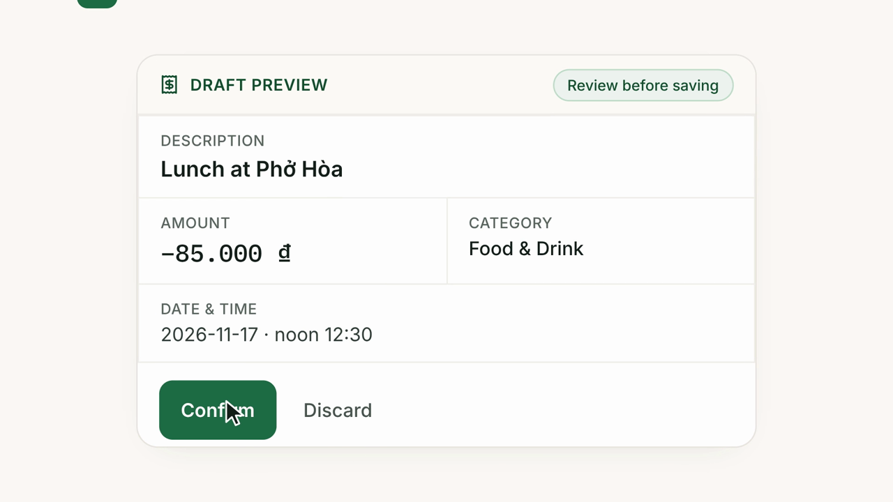

<div align="center">

  # Where My Buck Go

  **A personal finance assistant that keeps every decision in your hands.**

  Say what you spent, or snap a receipt. The assistant prepares a draft; nothing reaches your ledger until you confirm it.

  [Live app](https://d1498jatb9ljtb.cloudfront.net) · [Deployment runbook](deploy/aws/README.md)
</div>

---

## How it works

<table>
  <tr>
    <td width="33%"></td>
    <td width="33%"></td>
    <td width="33%"></td>
  </tr>
  <tr>
    <td align="center"><strong>1. Say it</strong><br />Describe a spend in plain language or attach one receipt image. The assistant proposes a draft.</td>
    <td align="center"><strong>2. Review it</strong><br />Check the amount, category, and date. Confirm or discard &mdash; the model can never save on its own.</td>
    <td align="center"><strong>3. See your month</strong><br />Confirmed entries update totals, categories, and recent transactions right away.</td>
  </tr>
</table>

## Product highlights

- **Review before saving:** entries stay drafts until you explicitly confirm them.
- **Keep the source:** a receipt stays attached to its draft and transaction as evidence.
- **Understand the month:** spending, income, categories, and history at a glance.

### Core capabilities

- Record income and expenses through chat or a single receipt image.
- Ask owner-scoped questions about totals over supported date ranges.
- Preview and confirm creates, edits, deletes, and undo operations.
- Browse evidence, reports, saved conversations, and filtered CSV exports.
- Install it as a standalone PWA on iOS, or use it in any browser.
- Run locally with Docker Compose or use the deployed AWS application.

## Run locally

### Requirements

- Docker Engine with Docker Compose
- A Gemini API key for AI chat and receipt extraction (optional for the rest of the app)

### Start the stack

```sh
cp .env.example .env
# Set AUTH_HMAC_KEY to a random secret of at least 32 bytes.
# Set GEMINI_API_KEY to enable AI features.
docker compose -f compose.local.yml up -d --build
docker compose -f compose.local.yml exec backend wmbg-bootstrap owner
```

Open [http://localhost:3100](http://localhost:3100). On later starts, omit the bootstrap command if an owner already exists. Stop the services with `docker compose -f compose.local.yml down`; this preserves local database and evidence volumes. Avoid `-v` unless you intend to delete that data.

For host-based development, Python and frontend commands are documented in [AGENTS.md](AGENTS.md). The current AWS architecture, provisioning and release process are in [deployment plan](deploy/aws/DEPLOYMENT_PLAN.md) and the [AWS operations runbook](deploy/aws/README.md).

## Architecture

```text
Next.js web app ── same-origin API proxy ── Flask API ── PostgreSQL
                                              ├── Gemini (structured extraction and chat)
                                              └── private evidence storage
```

- **Frontend:** Next.js, React, TypeScript.
- **Backend:** Python, Flask, SQLAlchemy, Alembic, PostgreSQL.
- **AI:** Gemini structured function calls; server-side validation controls all proposed actions.
- **Local evidence:** private filesystem volume. **Production evidence:** private AWS S3 bucket.
- **Production:** AWS EC2 and CloudFront with managed RDS PostgreSQL and Terraform-managed infrastructure.

More on the product and its safety rules: [SRD](docs/SRD.md). Contributor conventions: [AGENTS.md](AGENTS.md).

## Safety model

- No public registration; the owner account is bootstrapped by an operator.
- Model output is untrusted and cannot execute SQL or confirm a ledger change.
- Mutating requests require authentication, CSRF protection, idempotency keys, and version checks.
- Receipt and chat content are private evidence; never commit real financial records or credentials.

## Checks

```sh
./.venv/bin/pytest backend/tests -q
./.venv/bin/ruff check backend
./.venv/bin/mypy --config-file backend/pyproject.toml backend/src/where_my_buck_go
cd frontend && npm ci && npm run lint && npm run build
```

PostgreSQL integration tests require a disposable `TEST_DATABASE_URL`. Browser tests use `npm run test:e2e` from `frontend/` and Playwright Chromium.

## Demo video

The 15-second demo shown on the landing page is authored as code with [HyperFrames](https://github.com/heygen-com/hyperframes) in [`demo/`](demo/). It uses synthetic data only; interface elements are rebuilt from the frontend source, not recorded from a real account.

To edit or re-render, install Node.js 22+ and FFmpeg, then run:

```sh
cd demo
npm run dev                             # live preview in the browser
npm run check                           # lint, layout, motion, and contrast checks
npx hyperframes render -o ../frontend/public/demo.mp4   # served by the landing page
```

## License

This project is licensed under the [MIT License](LICENSE).
